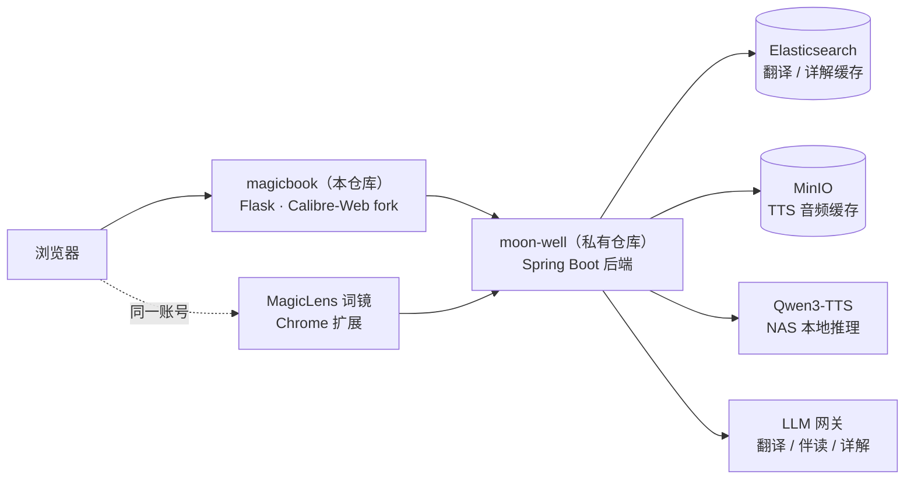

# MagicBook 魔法书

把一座 Calibre 电子书库，变成「选书 → 读 → 查 → 听 → 练」闭环的 AI 英语分级阅读站点。

选书按你的词汇量推荐，阅读时逐词判定生词、划词即得翻译与详解，可以听整本书，读完后有复习队列和口语/写作训练等着你——AI 能力按积分计费，账号、生词本、学习记录全端互通。

在线站点：**<https://magicbook.haoshenqi.top>**（邀请制注册，登录走统一账号中心 OIDC）

## 项目组成

| 项目 | 仓库 | 说明 |
| --- | --- | --- |
| MagicBook（本仓库） | [haoshenqi-family/magicbook](https://github.com/haoshenqi-family/magicbook) | 阅读站点本体：书库 + 阅读器 + 学习中枢，基于 [Calibre-Web](https://github.com/janeczku/calibre-web) 深度改造 |
| moon-well | 私有仓库 | 后端 API：词汇判定、翻译、单词详解、TTS、AI 伴读、积分计费 |
| MagicLens 词镜 | [haoshenqi-family/magiclens](https://github.com/haoshenqi-family/magiclens) | Chrome 扩展：把划词查词、生词高亮、AI 伴读带到**任意网页**，与本站同一账号、同一生词本 |

## 核心功能

### 📚 书库

- 兼容 Calibre 书库：书架浏览、搜索、元数据管理，EPUB / PDF / TXT 等格式上传下载
- 内置 **TED 演讲**与 **BBC 6 Minute English** 素材一键导入，自带真人原声与逐段时间轴
- 整本翻译：后台任务翻译全书，读的时候逐段对照
- OPDS / Kobo 设备同步、邮件推送等上游 Calibre-Web 能力保留

### 📖 阅读器

- 网页阅读 EPUB / PDF / TXT，5 个内置主题跟随账号跨设备同步
- 翻译三级：悬停段落点「译」→ 整页翻译 → 整本翻译
- 划词查词 + 单词详解（基本意思 / 词源 / 搭配用法 / 同反义词等六板块），变形词自动还原词目
- 生词智能高亮：按你的难度档位自动判定，生词波浪线标注，与生词本联动
- TTS 朗读：本地神经网络语音合成，顶栏 1.0x / 0.75x / 0.5x 三档语速（变速不变调，初学者友好）
- 整本连播：逐段顺序听完整本书；TED / BBC 书直接播真人原声，逐段高亮跟随
- 新概念课级音频、AI 批注、阅读进度跨设备续读

### 🧠 词汇学习

- 生词判定按「屈折词族」生效：标过 `run`，遇到 `ran` / `runs` 同样算认识
- 阅读中一键标记 认识 / 生词，数据进生词本与复习队列
- 词汇量测试：分档粗测 + 细筛估算，测出可用于选书的难度档位
- 选书难度匹配：每本书标注「约 N 个重复超纲词」，按当前档位推荐

### 📅 每日学习

- 复习队列：辨析 / 回忆 / 拼写三梯度，四档评分的间隔重复（SRS）
- 听写、AI 口语陪练、复述训练 4-3-2、计时重读、写作工坊、单词编故事
- 今日计划与本周「听 / 说 / 读 / 写」四股统计

### 🤝 AI 伴读

- 阅读页右侧抽屉就当前书提问，AI 可代翻段落、代查词（工具调用）
- 跨书记忆与「AI 了解我」自我介绍，越用越懂你
- 伙伴（buddy）形象 + 全局悬浮球，随处唤起

### 💳 积分与账号

- AI 能力按 token 换算积分，新账号注册即赠 1000 积分
- 支付宝扫码充值；积分卡可购买、转赠、兑换
- 站内信（积分到账、余额提醒）、成就徽章、学习数据一键导出（加密 ZIP，保留 7 天）
- 管理端：用户管理、运营站内信群发、LLM 任务面板

## 快速上手

1. **登录**：打开 <https://magicbook.haoshenqi.top>，经统一账号中心 `account.haoshenqi.top` 完成 OIDC 登录（没有账号先走邀请注册）。
2. **引导**：首次登录自动进入 2 分钟使用引导（可跳过，之后在设置下拉「使用引导」重看）。
3. **定档**：做一次词汇量测试（首页书墙上方入口，或「账号 → 阅读与词汇」），得到难度档位。
4. **选书开读**：首页「分级推荐」按档位选书进入阅读器；段落旁点「译」看译文，工具栏可整页 / 整本翻译。
5. **查词与听书**：划词看详解、标认识 / 生词；点段落「朗读」听单段，「整本连播」听全书；TED / BBC 书可原声伴听，语速不够快就切 0.75x / 0.5x。
6. **每天复习**：进「学习」完成当日复习队列；AI 伴读在阅读页抽屉，随时就当前书提问。
7. **（可选）装扩展**：从 [MagicLens Releases](https://github.com/haoshenqi-family/magiclens/releases) 安装 Chrome 扩展，任意网页划词即得同一套查词 / 高亮 / 伴读能力。

## 架构一览



- 账号：统一账号中心（Authentik）OIDC 登录，magicbook / MagicLens / moon-well 同一账号体系，注册为邀请制。
- 缓存：段落翻译与单词详解落 Elasticsearch、TTS 音频落 MinIO，重复内容命中缓存不重复计费；缓存全降级不影响功能。
- TTS：默认走 NAS 本地部署的 Qwen3-TTS（零边际成本），云服务仅作回落。

## 本地开发

```bash
python3 -m venv .venv && source .venv/bin/activate
pip install -r requirements.txt
python cps.py                                # 启动，首次需配置 Calibre 书库路径
.venv/bin/python -m pytest tests/            # 全量单测
```

- 部署：push `develop` 分支即触发 fnOS 自动构建镜像并部署（纯文档 push 自动跳过）；`master` 仅用于发布。
- 开发约定、文档体系与工作流详见 [AGENTS.md](AGENTS.md)；产品功能手册见 [docs/product/readme/](docs/product/readme/readme.md)。

## 致谢与许可

本项目 fork 自 [Calibre-Web](https://github.com/janeczku/calibre-web)（又源于 [library](https://github.com/mutschler/calibreserver)），在其书库与阅读底座上重构为 AI 英语学习站点；感谢上游所有[贡献者](https://github.com/janeczku/calibre-web/graphs/contributors)。

按 **GPL-3.0** 协议开源，详见 [LICENSE](LICENSE)。
